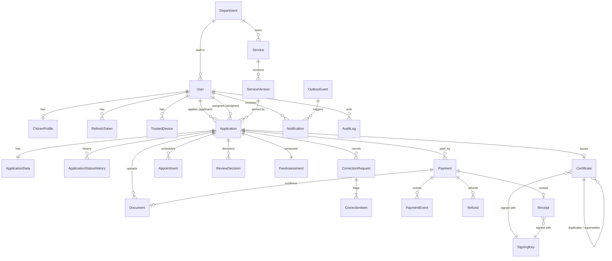

# GovServe data model

Version 1.0 (Phase 0), 2026-10-13. PostgreSQL 16 via Prisma (ADR-0002). Requirements: docs/SPEC.md. Statuses: docs/STATE_MACHINES.md.

Conventions:
- Primary keys are `uuid` (v7, time-ordered). Human-facing numbers (reference, receipt, certificate) are separate unique columns.
- Every table has `createdAt` and `updatedAt` (timestamptz, UTC). Mutable aggregates have a `version int` column for optimistic locking.
- Money is `bigint` cents (`…Cents`), USD only, so there is no currency column. Prisma `BigInt`; JSON responses use strings.
- **🔒** = encrypted at rest (AES-256-GCM via the crypto service, stored as `bytea` envelope `{keyId, iv, tag, ct}`).
  **#** = blind index column `…Bidx` (HMAC-SHA-256 with a separate key) for equality search.
- Enums are Postgres enums managed by Prisma.

## 1. Identity and access
### User
| Field | Type | Notes |
| --- | --- | --- |
| id | uuid PK | |
| email | citext unique | Required (DECISIONS) |
| emailVerifiedAt | timestamptz? | |
| passwordHash | text? | argon2id; null until invited staff sets it |
| fullName | text | Not encrypted (shown on certificates, used in search) |
| phone🔒 / phoneBidx# | bytea? / text? | |
| role | enum Role {CITIZEN, OFFICER, SUPERVISOR, ADMIN} | Exactly one role per user |
| departmentId | uuid? FK Department | Required for OFFICER/SUPERVISOR, null otherwise (check constraint) |
| status | enum {ACTIVE, LOCKED, DEACTIVATED} | |
| failedLoginCount, lockedUntil | int, timestamptz? | FR-004 |
| lastLoginAt | timestamptz? | |
Indexes: unique(email); (role, departmentId); phoneBidx.

### CitizenProfile (1:1 User, citizens only)
| Field | Type | Notes |
| --- | --- | --- |
| userId | uuid PK/FK | |
| nationalIdType | enum {NATIONAL_ID, PASSPORT} | |
| nationalId🔒 / nationalIdBidx# | bytea / text | unique(nationalIdBidx) where not null |
| dateOfBirth🔒 | bytea | |

### Department
`id, code unique (ADDRESS, POLICE, CIVIL_REGISTRY), name, active`.

### RefreshToken
`id, userId FK, familyId uuid, tokenHash text unique (SHA-256), expiresAt, rotatedAt?, revokedAt?, revokedReason?, ip, userAgent`.
Index (userId), (familyId). Reuse of a rotated token revokes every row in the family (ADR-0003).

### OtpCode
`id, userId FK?, email, purpose enum {VERIFY_EMAIL, RESET_PASSWORD, STAFF_DEVICE, CHANGE_EMAIL}, codeHash, expiresAt, attempts int, consumedAt?`.
Index (email, purpose, consumedAt).

### StaffInvitation
`id, email, role, departmentId?, tokenHash unique, invitedById FK User, expiresAt, acceptedAt?`.

### TrustedDevice
`id, userId FK, deviceIdHash, lastSeenAt, expiresAt (30 d), revokedAt?`. unique(userId, deviceIdHash).

## 2. Catalogue
### Service
`id, code unique (PROOF_OF_ADDRESS, POLICE_CLEARANCE, BIRTH_CERTIFICATE), name, description, departmentId FK,
active bool, slaWorkingDays int, inPersonStep enum {NONE, FINGERPRINTS, APPEARANCE}, approvalMode enum {SINGLE,
SUPERVISOR_SECOND, SUPERVISOR_ON_RECORD_FOUND}, validityMonths int?, certificatePrefix text (ADR, POL, BRT), subjectMode
enum {SELF, SELF_OR_CHILD}`.

### ServiceVersion (immutable once published)
| Field | Type | Notes |
| --- | --- | --- |
| id | uuid PK | |
| serviceId | FK Service | |
| versionNo | int | unique(serviceId, versionNo) |
| status | enum {DRAFT, PUBLISHED, RETIRED} | at most one PUBLISHED per service (partial unique index) |
| formSchema, uiSchema | jsonb | JSON Schema; PII fields tagged `x-pii: true` so they route to encrypted columns |
| requiredDocuments | jsonb | `[{type, label, mime[], maxBytes, required, oneOfGroup?}]` |
| feeBaseCents, feePerCopyCents | bigint | ≥ 0 (check). The fee rule (FR-040) |
| feeIsTest | bool | true until the owner confirms the official fee (O-1); flagged in the admin UI |
| publishedAt, publishedById | timestamptz?, FK? | |

### Setting
`key text PK, value jsonb, updatedById, updatedAt`. Keys: `payment.supervisorThresholdCents` (10000),
`correction.deadlineDays` (30), `correction.maxRounds` (3), `claim.expiryWorkingDays` (2), `payment.unpaidAbandonDays` (30),
`retention.documentYears` (7), `retention.draftDays` (90), `appointment.maxReschedules` (2).

### Holiday
`date PK, name`. The working-week definition is held in a Setting.

### ReasonCode
`id, kind enum {REJECT, PAYMENT_REJECT, REVOKE, REFUND_DECLINE}, code, label, active`. unique(kind, code).

## 3. Applications
### Application
| Field | Type | Notes |
| --- | --- | --- |
| id | uuid PK | |
| referenceNo | text unique? | `GS-YYYY-NNNNNN`, set on submit from sequence `application_ref_seq` |
| kind | enum {STANDARD, DUPLICATE} | |
| applicantId | FK User | owner |
| serviceId, serviceVersionId | FK | pinned at creation |
| departmentId | FK Department | denormalised from Service for scope filters |
| subjectType | enum {SELF, CHILD} | |
| subjectKey | text | Normalised hash of the subject (applicant id for SELF; HMAC(name+DOB+mother) for CHILD). Used for FR-031 |
| relationship | enum {SELF, MOTHER, FATHER, GUARDIAN} | |
| extraCopies | int 0–5 | |
| sourceCertificateId | FK Certificate? | DUPLICATE kind only |
| status | enum ApplicationStatus | see STATE_MACHINES §1 |
| assigneeId | FK User? | |
| claimExpiresAt | timestamptz? | |
| correctionRound | int default 0 | |
| correctionDueAt | timestamptz? | |
| slaDueAt, slaPausedAt | timestamptz? | |
| slaPausedTotalMs | bigint default 0 | |
| slaBreachedAt | timestamptz? | set once when the SLA is first missed (one breach notice) |
| reviewOutcome | enum {NO_RECORD, RECORD_FOUND}? | police only |
| chargebackFlag | bool default false | |
| submittedAt, queuedAt, decidedAt | timestamptz? | |
| version | int | optimistic lock |
Indexes: **partial unique (applicantId, serviceId, subjectKey) WHERE kind='STANDARD' AND status IN (open states)**
(FR-031); (departmentId, status, slaDueAt) for queues; (assigneeId, status); keyset (applicantId, createdAt desc, id desc) and
(departmentId, createdAt desc, id desc) (Phase 08); GIN trigram on referenceNo for partial search;
trigram on referenceNo.

### ApplicationData (1:1 Application)
`applicationId PK/FK, data jsonb` (answers to fields not marked `x-pii`), `piiEnc🔒 bytea?` (all `x-pii` answers as one
encrypted JSON object; field sets vary by service, so per-field columns do not fit configurable forms),
`subjectFullName text?` (from `subjectFullName`/`fullName`, plain for search), `subjectNationalIdBidx#` (from `idNumber`).
Police "record found" notes are stored encrypted with the review decision (Phase 06). Changed 2026-10-13 (Phase 04).

### ApplicationStatusHistory (append-only)
`id, applicationId FK, fromStatus?, toStatus, actorId?, actorType enum {USER, SYSTEM}, note?, at`. Index (applicationId, at).

### Document
| Field | Type | Notes |
| --- | --- | --- |
| id | uuid PK | |
| applicationId | FK? | null for payment evidence before linking |
| paymentId | FK? | |
| ownerId | FK User | |
| docType | text | matches requiredDocuments.type |
| storageKey | text unique | opaque key `docs/{uuid}`, never derived from the file name |
| originalName, mime, sizeBytes, sha256 | text, text, int, text | MIME checked by magic bytes |
| status | enum {PENDING_UPLOAD, QUARANTINED, CLEAN, INFECTED, REJECTED} | PENDING_UPLOAD until the client confirms; REJECTED when size, type (by content) or SHA-256 do not match |
| statusReason | text? | shown to the citizen |
| supersededById | FK Document? | replaced upload (corrections keep history) |
| purgedAt | timestamptz? | retention (FR-151/152): object deleted, row kept; API shows `purged` and answers 410 on download |
Index (applicationId, docType), (scanStatus, createdAt).

### CorrectionRequest / CorrectionItem
`CorrectionRequest: id, applicationId FK, round int, requestedById, dueAt, resolvedAt?, reminder7At?, reminder1At?`
unique(applicationId, round). The reminder columns make the 7-day and 1-day reminders send once.
`CorrectionItem: id, correctionRequestId FK, kind enum {FIELD, DOCUMENT}, target text (field name or docType), comment, resolvedAt?,
originalValueHash?` — a keyed hash (domain `correction`) of the flagged answer when the round opened, so resubmission can require a
change without storing the old PII value.

### Appointment
`id, applicationId FK, kind enum {FINGERPRINTS, APPEARANCE}, scheduledAt, location, status enum {SCHEDULED, ATTENDED,
NO_SHOW, CANCELLED}, attendees jsonb? (names and roles, birth), recordedById?, recordedAt?, rescheduleCount int`.
Index (applicationId), (status, scheduledAt).

### ReviewDecision
`id, applicationId FK, level enum {OFFICER, SUPERVISOR}, decision enum {APPROVE, FORWARD, RETURN, REJECT, REFER},
outcome enum? (NO_RECORD/RECORD_FOUND), reasonCodeId?, note?, decidedById FK, decidedAt`. Check: the supervisor decision
user ≠ the officer decision user (enforced in the service and a trigger).

## 4. Fees and payments
### FeeAssessment (immutable, 1:1 Application)
`id, applicationId unique FK, lines jsonb [{code: BASE|COPY, qty, unitCents, amountCents}], totalCents bigint,
ruleSnapshot jsonb (versionNo, base, perCopy, feeIsTest), assessedAt`.

### Payment
| Field | Type | Notes |
| --- | --- | --- |
| id | uuid PK | |
| applicationId | FK | |
| channel | enum {MOBILE_MONEY, BANK, CASH, CARD} | |
| provider | text | e.g. EVC_PLUS, SAHAL, bank code, MOCK_CARD |
| reference | text | transaction ID / slip no / receipt-book ref / gateway ref |
| referenceNorm | text | upper-cased and trimmed |
| amountCents | bigint > 0 | |
| paidAt | timestamptz | as reported or recorded |
| status | enum PaymentStatus | STATE_MACHINES §2 |
| idempotencyKey | text? unique | card initiate |
| payerName | text? | cash |
| evidenceDocumentId | FK Document? | mobile money / bank screenshot or slip photo |
| confirmedAt | timestamptz? | |
| recordedById | FK User? | cash |
| firstConfirmedById, confirmedById | FK User? | check: different users when both are set and the second confirmation was by a supervisor |
| rejectReasonCodeId, rejectNote | FK?, text? | |
| overpaidCents | bigint default 0 | |
| version | int | |
Indexes: **partial unique (channel, provider, referenceNorm) WHERE status <> 'REJECTED'** (FR-052); (applicationId);
(status, createdAt) for the verification queue joined to Application.departmentId.

### PaymentEvent (append-only)
`id, paymentId FK, type, fromStatus?, toStatus?, actorId?, payload jsonb (no PII), providerEventId text? unique, at`.
`providerEventId` unique provides webhook idempotency.

### Refund
`id, paymentId FK, reason enum {WITHDRAWN_BEFORE_REVIEW, DUPLICATE_PAYMENT, OVERPAYMENT, ABANDONED_UNPAID}, amountCents
bigint, status enum {REQUESTED, APPROVED, DECLINED, COMPLETED, FAILED}, requestedById?, approvedById?, payoutMethod?,
payoutReference?, providerRefundId? unique, note?, version`. Check: sum of non-DECLINED refunds ≤ payment amount (enforced in the service
under a row lock).

### Receipt
`id, receiptNo unique (R-YYYY-NNNNNN), paymentId unique FK, applicationId FK, amountCents, issuedAt, payloadJson jsonb
(canonical), signature bytea, keyId FK SigningKey`. Status is derived from the payment and its refunds. The PDF is
rendered on demand from the immutable signed payload, so nothing is stored (changed 2026-10-13, Phase 05). Receipt
numbers use the fiscal year = calendar year in Africa/Mogadishu.

### Counter (gap-free numbering)
`name text PK (e.g. receipt:2026, cert:ADR:2026), nextValue bigint`. Incremented with `SELECT … FOR UPDATE` inside
the issuing transaction.

## 5. Certificates and signing
### Certificate
| Field | Type | Notes |
| --- | --- | --- |
| id | uuid PK | |
| certificateNo | text unique | `{prefix}-YYYY-NNNNNN` |
| applicationId | FK | |
| serviceId | FK | |
| holderUserId | FK User | applicant (owner) |
| subjectKey | text | for supersede lookup |
| holderName | text | full name, for name-match verification |
| holderNameMasked | text | precomputed for the public page |
| issuedAt | timestamptz | |
| expiresAt | timestamptz? | null for birth |
| status | enum {VALID, REVOKED} | EXPIRED derived |
| revokedAt, revokedById, revokeReason enum {FRAUD, ERROR, CHARGEBACK, SUPERSEDED}, revokeNote | | |
| duplicateOfId | FK Certificate? | |
| supersededById | FK Certificate? | |
| payloadJson, signature, keyId | jsonb, bytea, FK | ADR-0006 |
Indexes: (serviceId, subjectKey, status); (holderUserId); unique(certificateNo). Partial unique (serviceId, subjectKey) WHERE
status = VALID AND duplicateOfId IS NULL (one valid original per subject). The PDF is rendered on demand from the signed payload
and the application's answers, so nothing is stored (changed 2026-10-13, Phase 06; `pdfStorageKey` and `pdfStatus` dropped).

### SigningKey
`id (keyId, text), algorithm 'Ed25519', publicKey bytea, status enum {ACTIVE, RETIRED}, activatedAt, retiredAt?`.
The private key is held in the secret store, not the DB.

## 6. Notifications, jobs, audit
### OutboxEvent
`id, type, aggregateType, aggregateId, payload jsonb, createdAt, dispatchedAt?, attempts`. Written in the same transaction as the
state change and relayed to BullMQ (ADR-0005). Index (dispatchedAt NULLS FIRST, createdAt).

### Notification
`id (uuid v7, time-ordered), userId FK, eventId FK OutboxEvent? (null for direct sends: codes and invitations), channel enum
{EMAIL}, template, vars jsonb (non-PII only: referenceNo, applicationId, dueAt, daysLeft, appointmentAt, location), mandatory
bool, status enum {QUEUED, SENT, FAILED, SKIPPED, DEAD}, attempts, providerMessageId?, lastError? (transport code only), readAt?,
sentAt?, createdAt, updatedAt`. unique(eventId, channel, userId) (idempotency); index (userId, createdAt desc), (status,
updatedAt). Check: SKIPPED only when not mandatory. See ADR-0008.

### NotificationPreference
`userId PK/FK, emailOptional bool default true, updatedAt` (affects only the optional templates: submitted, payment
received, withdrawn).

### AuditLog (append-only, hash-chained)
| Field | Type | Notes |
| --- | --- | --- |
| id | bigint identity PK | ordering for the chain |
| occurredAt | timestamptz | |
| actorId, actorRole, actorType | uuid?, text?, enum {USER, SYSTEM, PUBLIC} | |
| action | text | e.g. APPLICATION_SUBMITTED (STATE_MACHINES tables) |
| entityType, entityId | text, text | |
| departmentId | uuid? | scope for the supervisor viewer |
| before, after | jsonb? | PII redacted |
| ip, userAgent, requestId | text? | |
| prevHash, hash | bytea | hash = SHA-256(prevHash ‖ canonical row), set by the insert trigger |
| chainSeq | bigint unique | chain position in commit order (trigger, advisory lock) |
Indexes: (entityType, entityId, occurredAt); (actorId, occurredAt); (departmentId, occurredAt); (action).
The API's role (`govserve_app_rw`) has INSERT and SELECT only; triggers block UPDATE, DELETE and TRUNCATE for everyone.
`audit_verify()` returns the first broken link. See ADR-0010.

### AuditCheckpoint
`id, chainSeq, hash, verifiedAt`: the head of the chain at the last successful verification. Append-only, like
`audit_log`. Used to detect rows removed from the end of the chain.

## 7. ER diagram (core)

## 8. Retention mapping (FR-150–152)
| Data | Retention | Mechanism |
| --- | --- | --- |
| Certificate, Receipt, Payment, Refund, AuditLog | Indefinite | — |
| Document objects (decided applications) | 7 years after decidedAt (setting) | Nightly job deletes the object and sets purgedAt |
| Drafts | 90 days idle → ABANDONED, uploads purged | Nightly job (A4) |
| WITHDRAWN/ABANDONED uploads | 90 days | Nightly job |
| Unverified citizen accounts | 7 days | Nightly job |
| OtpCode, expired RefreshToken | 30 days after expiry | Nightly job |
Legal sign-off: O-5.

## Search indexes (Phase 08)
- Full-text: GIN on `to_tsvector('simple', coalesce(user.fullName, ''))` and on `application_data.subjectFullName`
  ('simple' configuration: Somali names are not stemmed). Queries use prefix terms (`hod:* & ali:*`).
- Partial reference numbers: GIN `gin_trgm_ops` on `application.referenceNo`.
- Keyset pagination on (createdAt DESC, id DESC): `application` per applicant and per department; `payment` globally and
  (applicationId, createdAt).
- National ID and phone are matched only through blind indexes (`citizen_profile.nationalIdBidx`,
  `application_data.subjectNationalIdBidx`, `user.phoneBidx`).
- Plans on 100,000 seeded rows: docs/perf/search-plans.md.

## Reporting views (Phase 09, ADR-0009)
- `report_money_movement`: one row per money movement from `payment_event`:
  - CONFIRMED (+): a payment entering CONFIRMED
  - REVERSED (−): a card reversal
  - REFUNDED (−): a `REFUND_COMPLETED` event, using the refund's amount and the original payment's channel

  Columns: eventId, occurredAt, kind, paymentId, applicationId, referenceNo, departmentId, serviceId, serviceCode,
  serviceName, channel, amountCents (bigint). Net collections = Σ CONFIRMED − Σ REFUNDED − Σ REVERSED, which equals
  Σ currently CONFIRMED payments − Σ completed refunds. Index `payment_event (at)` serves date ranges.
- `report_application`: one row per non-draft application, with service, status, timestamps, SLA fields, assignee,
  assessed and confirmed-paid cents, and `outstandingCents` (AWAITING_PAYMENT only).

