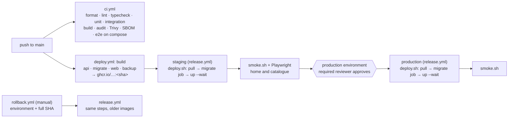

# GovServe runbook

Operations for the deployed portal: one Linux VM per environment running Docker Compose (ADR-0011), images in GHCR,
deploys from GitHub Actions. Targets: RPO 24 h, RTO 4 h (NFR-007).

| Where | What |
| --- | --- |
| `infra/docker-compose.prod.yml` | The stack: caddy → web (nginx) → api, postgres, redis, clamav, backup, prometheus, alertmanager |
| `infra/deploy/deploy.sh`, `smoke.sh` | Deploy one release over SSH; post-deploy checks |
| `.github/workflows/` | `ci.yml` (checks), `deploy.yml` (main → staging → production), `release.yml` (reusable), `rollback.yml` |
| `infra/backup/` | Nightly encrypted backups, restore drill |
| `infra/prometheus/alerts.yml` | Alert rules; each links to a section below |
| VM `/opt/govserve` | `releases/<sha>/` (last five), `current` → live release, `history` (one line per deploy) |

On the VM, use plain `docker` (`docker ps`, `docker logs govserve-stack-api-1`, `docker exec ...`). `docker compose`
needs the deploy session's variables and secrets, which exist only while a deploy runs.

## Deploy pipeline



`ci.yml` and `deploy.yml` both start on a push to main. Protect `main` so that only pull requests with a green
`ci.yml` can merge; a push to main is then already checked when it deploys.

## First-time setup

### GitHub
1. Create the environments **staging** and **production**. Add yourself and one other person as required reviewers on
   production, and restrict both environments to the `main` branch.
2. Add the variables and secrets below to each environment.
3. Create a fine-grained token (or a machine user's classic token) with `read:packages` only, and store it as
   `GHCR_READ_TOKEN`. The VM pulls images with it; the workflow's own token is used only to push.

| Environment variable (`vars.*`) | Example / note |
| --- | --- |
| `SSH_HOST`, `SSH_USER` | `203.0.113.10`, `deploy` |
| `SITE_ADDRESS` | `gov.example.so` (Caddy obtains the certificate) |
| `WEB_ORIGIN` | `https://gov.example.so` |
| `OBJECT_STORE_ORIGIN` | Public origin of the documents bucket, allowed by the CSP, e.g. `https://s3.eu-central-1.example.com` |
| `S3_ENDPOINT`, `S3_PUBLIC_ENDPOINT`, `S3_REGION`, `S3_BUCKET`, `S3_FORCE_PATH_STYLE`, `S3_ACCESS_KEY_ID` | Documents bucket (private) |
| `SMTP_HOST`, `SMTP_PORT`, `SMTP_FROM`, `SMTP_USER`, `SMTP_SECURE`, `SMTP_REQUIRE_TLS` | Mail relay; port 587 with `SMTP_REQUIRE_TLS=true`, or 465 with `SMTP_SECURE=true` |
| `CARD_GATEWAY` | `disabled` in production until O-7; `mock` is allowed on staging |
| `ALERT_EMAIL_TO` | Where Alertmanager sends alerts |
| `BACKUP_AGE_RECIPIENT` | Public age key, `age1…` (see [Backups](#backups)) |
| `BACKUP_S3_ENDPOINT`, `BACKUP_S3_REGION`, `BACKUP_BUCKET`, `BACKUP_S3_ACCESS_KEY_ID` | Backup bucket, separate account/credentials from the documents bucket |
| `LOG_LEVEL` | `info` |
| `GHCR_USER` | Owner of `GHCR_READ_TOKEN` |

| Environment secret (`secrets.*`) | How to make it |
| --- | --- |
| `SSH_KEY` | Private key of a deploy-only key pair (`ssh-keygen -t ed25519 -N ''`) |
| `SSH_KNOWN_HOSTS` | `ssh-keyscan -t ed25519 <host>`, checked against the VM console's fingerprint |
| `POSTGRES_PASSWORD` | `openssl rand -base64 32 \| tr -d '/+='` |
| `DATABASE_URL` | `postgresql://govserve:<POSTGRES_PASSWORD>@postgres:5432/govserve` (owner: migrations, backups) |
| `DATABASE_APP_URL` | `postgresql://govserve_app:<new random>@postgres:5432/govserve` (the API; the release job creates the role) |
| `REDIS_PASSWORD` | Random, as above |
| `REDIS_URL` | `redis://default:<REDIS_PASSWORD>@redis:6379` |
| `S3_SECRET_ACCESS_KEY`, `SMTP_PASSWORD`, `BACKUP_S3_SECRET_ACCESS_KEY` | From the providers |
| `CARD_WEBHOOK_SECRET` | `openssl rand -base64 48` (from the gateway once O-7 is chosen) |
| `JWT_ACCESS_SECRET`, `METRICS_TOKEN`, `BACKUP_CRYPT_PASSWORD` | `openssl rand -base64 48` each |
| `PII_KEYS` | `pii-2026-10:<openssl rand -base64 32>` (see [PII keys](#pii-encryption-keys)) |
| `BLIND_INDEX_KEY` | `openssl rand -base64 32` |
| `SIGNING_KEYS` | `sig-2026-10:<openssl genpkey -algorithm ed25519 -outform DER \| base64>` |
| `GHCR_READ_TOKEN` | See step 3 |

Staging and production never share a secret. Record who generated each one and when in the team's password manager,
the only copy besides GitHub.

### The VM
1. Ubuntu 24.04 LTS with an **encrypted disk** (Compose keeps each container's secret files under `/var/lib/docker`),
   4 vCPU, 8 GB RAM (ClamAV needs 2 GB), 80 GB. Turn on unattended security upgrades and time sync.
2. Install Docker Engine and the Compose plugin from Docker's apt repository. Create the `deploy` user in the `docker`
   group (this is root-equivalent: only the deploy key logs in as it) and `/opt/govserve` owned by `deploy`.
3. Firewall: 22 from the operators' and GitHub runners' addresses only, 80/tcp, 443/tcp and 443/udp. Nothing else is
   published: Postgres, Redis and Prometheus are on the internal `app` network.
4. DNS: an A/AAAA record for `SITE_ADDRESS` pointing at the VM, before the first deploy (Caddy needs it for the
   certificate).
5. Documents bucket: private, versioning on, CORS allowing `PUT` and `GET` from `WEB_ORIGIN`. Backup bucket: another
   account or credentials, versioning plus object lock (governance, 30 days) if the provider has it.
6. Run **Deploy** (`workflow_dispatch`) or push to main. Then create the first admin and open the printed link:
   ```sh
   docker exec -it govserve-stack-api-1 node dist/cli/bootstrap-admin.js --email admin@bra.gov.so --name "Full Name"
   ```

## Deploy

A push to main deploys automatically: images are built once and tagged with the commit SHA, staging gets them first
and must pass the smoke checks, and production waits for a reviewer's approval in the Actions run. The same images run
in both environments.

`deploy.sh` per environment:
1. Copies the compose file and configs to `/opt/govserve/releases/<sha>/`.
2. Streams the variables and secrets to the remote shell over SSH stdin (never to disk or a command line).
3. Pulls the images, runs the **release job** (`migrate`: `prisma migrate deploy` as the owner, creates or updates
   the `govserve_app` login role, idempotent reference data). The API never migrates on start.
4. `docker compose up -d --wait`: each service is replaced only once its dependencies are healthy. If the release job
   or a health check fails, the deploy stops and the previous containers keep serving whatever was not yet replaced.
5. Points `current` at the release, appends to `history`, keeps the last five releases.

`smoke.sh` then checks `/ready` (database and Redis up, the expected release), the security headers, the catalogue,
the receipt lookup and that `/metrics` is not public. Staging also runs the Playwright home and catalogue journeys.

Expect a few seconds of 502s while the API container is replaced (single VM, no blue/green).

## Rollback

**Actions → Rollback → Run workflow**, choose the environment and paste the full 40-character SHA of the release to
restore (from `/opt/govserve/history` or the Deploy run). It reruns `release.yml` with those images.

**Migrations only move forward.** The release job of an older release finds nothing to apply, and the newer schema
stays. A rollback is safe when the newer release's migrations were additive (new tables, columns with defaults,
indexes), which is the rule for every migration in this repo. If a release dropped or renamed something the older code
uses, do not roll back: ship a fix forward, or restore a backup (data written since is lost).

## Rotating keys and secrets

Every rotation is: change the value in the GitHub environment, then redeploy (Deploy for the current main, or Rollback
with the live SHA). `deploy.sh` labels each container with a digest of all secret values, so a changed secret
recreates the containers that mount it (Compose would otherwise keep the old value). Rotate staging first. Each change
of a signing key is also audited (`SIGNING_KEY_*`).

### Receipt and certificate signing keys (ADR-0006)
`SIGNING_KEYS` is a comma-separated list of `keyId:base64(PKCS#8 DER)`. The **first** key is ACTIVE and signs; every
other key is RETIRED: it no longer signs but stays published, so receipts and certificates it signed still verify.
1. `openssl genpkey -algorithm ed25519 -outform DER | base64` and pick a new id, e.g. `sig-2027-04`.
2. Put the new entry **first** and keep every old entry: `sig-2027-04:<new>,sig-2026-10:<old>`.
3. Redeploy. The API registers the new key as ACTIVE and the old one as RETIRED (`SIGNING_KEY_REGISTERED`,
   `SIGNING_KEY_RETIRED`).
4. Check: a new receipt's QR verifies, and an old receipt's QR still verifies.

Never remove a retired key while documents it signed can be presented. If a private key leaked, rotate as above at
once, then revoke the certificates signed with it after the leak (supervisor action, reason ERROR) and reissue.

### PII encryption keys
`PII_KEYS` is a key ring, `keyId:base64(32 bytes)`, first key encrypts. Every value records its key id, so older keys
still decrypt. Prepend a new key (`openssl rand -base64 32`) and redeploy; never drop an old key, because there is no
re-encryption job yet (follow-up). `BLIND_INDEX_KEY` is not rotated: changing it breaks lookups by national ID and
phone until the indexes are recomputed, which also needs that job. On compromise, treat it as an incident.

### JWT access secret
Replace `JWT_ACCESS_SECRET` and redeploy. Access tokens last 15 minutes and become invalid at once; browsers renew
them silently with their refresh cookie (refresh tokens are opaque and stored hashed, so they are unaffected). There
is no "sign everyone out" control yet; deactivating a staff account revokes that person's sessions.

### Database passwords
- **App role** (`DATABASE_APP_URL`): put a new password in the URL and redeploy. The release job runs
  `ALTER ROLE … PASSWORD` before the API is recreated.
- **Owner** (`POSTGRES_PASSWORD` and `DATABASE_URL`): Postgres reads its password file only when the data directory is
  first created, so change it in the database first, then in GitHub, then redeploy:
  ```sh
  docker exec -it govserve-stack-postgres-1 psql -U govserve -d govserve -c '\password govserve'
  ```

### Other secrets
- `REDIS_PASSWORD` and `REDIS_URL`: change both together and redeploy; Redis and the API restart (queued jobs are kept
  in the AOF).
- `METRICS_TOKEN`, `SMTP_PASSWORD`, `S3_SECRET_ACCESS_KEY`, `BACKUP_S3_SECRET_ACCESS_KEY`: create the new credential at
  the provider, update GitHub, redeploy, then revoke the old credential.
- `CARD_WEBHOOK_SECRET`: only one is accepted at a time, so coordinate the switch with the gateway (after O-7).
- `BACKUP_CRYPT_PASSWORD` (documents in the backup bucket): a new password applies to new copies only; keep the old one
  with the age key as long as backups made with it are retained (12 months).
- `SSH_KEY`: add the new public key to `~deploy/.ssh/authorized_keys`, update the secret, deploy, remove the old key.

## Backups

The `backup` container runs `backup.sh` daily at `BACKUP_AT` (01:30 Mogadishu time):
- Postgres: `pg_dump -Fc` as the owner, then `age`-encrypted to `BACKUP_AGE_RECIPIENT`.
- Redis: an RDB snapshot (queues, sessions), `age`-encrypted.
- Documents: the documents bucket copied through an rclone crypt remote (`BACKUP_CRYPT_PASSWORD`).
- A manifest with row counts and SHA-256 sums; `last-success.json` after each successful run.
- Kept: 14 daily, 8 weekly (Sundays), 12 monthly (1st).

The **age private key never goes on the VM.** Generate it offline (`age-keygen -o govserve-backup.key`), put the
printed public key in `BACKUP_AGE_RECIPIENT`, and keep the key file in two separate places held by different people.
Without it no backup can be read.

Run a backup now: `docker exec govserve-stack-backup-1 /backup/backup.sh`.

## Restore

### Monthly drill (also after any change to backups)
Restores the latest backup into a scratch database on the VM and checks checksums, row counts against the manifest,
`audit_verify()`, that the Redis snapshot loads with its queues, and that the document count matches. It never touches
the live database.
Each release directory carries `drill.compose.yml`. On the VM, in an interactive shell (`read -rs` keeps values out of
the history and the screen):
```sh
cd /opt/govserve/current
export REGISTRY=ghcr.io/<owner> RELEASE=$(basename "$(readlink -f .)")
export BACKUP_S3_ENDPOINT=… BACKUP_S3_REGION=… BACKUP_BUCKET=… BACKUP_S3_ACCESS_KEY_ID=… \
       S3_ENDPOINT=… S3_BUCKET=… S3_ACCESS_KEY_ID=… S3_FORCE_PATH_STYLE=…
for v in BACKUP_S3_SECRET_ACCESS_KEY BACKUP_CRYPT_PASSWORD S3_SECRET_ACCESS_KEY BACKUP_AGE_IDENTITY; do
  read -rs -p "$v: " "${v?}"; echo; export "${v?}"
done   # BACKUP_AGE_IDENTITY: the AGE-SECRET-KEY-… line of the offline key file
docker compose -f drill.compose.yml run --rm drill; docker compose -f drill.compose.yml down -v
exit   # the variables end with the shell
```
Locally: `make backup && make restore-drill`. Record the date, duration and result in the operations log.

### Real restore (data loss or corruption)
1. Declare an incident ([checklist](#incident-checklist)). Put the site in maintenance: `docker stop govserve-stack-web-1`.
2. Stop writers: `docker stop govserve-stack-api-1 govserve-stack-backup-1`.
3. Pick the backup: the last one before the damage (`daily/<date>` in the backup bucket).
4. Decrypt on an operator machine: `age -d -i govserve-backup.key -o postgres.dump postgres.dump.age` (same for
   `redis.rdb`), check `sha256sum -c SHA256SUMS`.
5. Postgres: copy the dump into the container and restore over a fresh database:
   ```sh
   docker cp postgres.dump govserve-stack-postgres-1:/tmp/
   docker exec govserve-stack-postgres-1 sh -c 'dropdb -U govserve --force govserve && createdb -U govserve govserve \
     && pg_restore -U govserve -d govserve --exit-on-error /tmp/postgres.dump && rm /tmp/postgres.dump'
   docker exec govserve-stack-postgres-1 psql -U govserve -d govserve -Atc 'SELECT count(*) FROM audit_verify()'  # 0
   ```
6. Redis: stop it, replace `dump.rdb` in the `govserve-stack_redisdata` volume, remove `appendonlydir`, start it.
7. Documents, if lost: `rclone copy` from the crypt remote back to the documents bucket.
8. Redeploy the live release (Rollback with the current SHA): the release job checks migrations and the app role,
   and every container comes back. Run the smoke checks.
9. Anything written after the backup is gone: compare the gateway's and mobile-money statements for that window and
   re-enter payments through the reconciliation screens.

## Alerts

Alerts come from Prometheus on the VM and are emailed by Alertmanager to `ALERT_EMAIL_TO`. Prometheus has no public
port; to look at it, `ssh -L 9090:<prometheus container IP>:9090 deploy@<host>` and use the IP from `docker inspect`.

### API down
`up{job="api"} == 0` for 2 minutes: Prometheus cannot scrape the API.
1. `docker ps -a --filter name=govserve-stack` — is `api` restarting or unhealthy?
2. `docker logs --tail 200 govserve-stack-api-1`. A configuration error names the variable (for example a secret that
   was emptied): fix it in GitHub and redeploy.
3. Check its dependencies: `postgres`, `redis` and `clamav` must be healthy (`clamav` takes about 3 minutes after a
   restart). Disk full? `df -h /`, then `docker system df`.
4. Right after a deploy: roll back to the previous SHA.

### High 5xx rate
More than 2% of API requests answer 5xx for 5 minutes.
1. Find the route: `sum by (route) (rate(http_requests_total{status=~"5.."}[5m]))` in Prometheus.
2. `docker logs govserve-stack-api-1 | grep '"level":50'` for the errors (with request IDs; no PII is logged).
3. One route after a deploy: roll back. Everything failing: check Postgres connections, Redis, the object store and
   SMTP reachability from the VM.

### Payment webhook failures
`payment_webhook_failures_total` rose in the last 10 minutes; the `reason` label says which:
- `signature`: a request with a bad HMAC or old timestamp. One or two are background noise; many, or every
  webhook, means `CARD_WEBHOOK_SECRET` no longer matches the gateway (after a rotation?) or someone is probing.
- `payload`: the gateway sent something we cannot parse (a version change?). Keep the gateway's delivery log.
- `processing`: our handler failed after a valid signature. The gateway retries; webhooks are idempotent. Check the
  API log for that request ID.
Payments affected meanwhile are found and fixed in the reconciliation screen. Never confirm a card payment by hand
without the gateway's record.

### Queue backlog
More than 200 waiting jobs in a queue, or the oldest waiting more than 15 minutes, for 10 minutes. Also fires as
**NotificationsDeadLettered** when an email gave up after its retries.
1. Which queue: `bullmq_jobs{state="waiting"}` and `bullmq_oldest_waiting_seconds` by `queue`.
2. Workers run in the API process: is the API healthy and not restarting? Is Redis full (`docker exec
   govserve-stack-redis-1 sh -c 'REDISCLI_AUTH=$(cat /run/secrets/redis_password) redis-cli info memory'`)?
3. `notifications`: SMTP rejecting us (check the relay's dashboard and the API log). A dead-lettered email is not
   retried; the recipient still has the in-app notification, marked "We could not email this message". There is no resend yet, so
   for anything urgent (a correction deadline) the office contacts the citizen.
4. `scan`: ClamAV unhealthy or still loading signatures.

### Audit chain broken
`audit_chain_ok == 0`: the nightly verifier found an audit row changed (`ROW_CHANGED`), a gap (`LINK_BROKEN`) or rows
missing at the end (`TAIL_REMOVED`). Admins also got an in-app notification. Treat it as a **security incident**:
someone with database owner access changed history (the app role cannot).
1. Do not try to repair the rows. Preserve evidence: take a backup now
   (`docker exec govserve-stack-backup-1 /backup/backup.sh`) and a copy of the VM's auth and Docker logs.
2. The admins' notification names the problem and the first bad `chainSeq`; find it in the audit viewer. Compare those
   rows with the same rows in the last backup from before the break (restore it into a scratch database as in the
   drill).
3. Rotate the database owner password and the SSH deploy key; review who had VM access.
4. Follow the incident checklist and report to the data protection owner.

## Incident checklist
1. **Declare:** one incident lead; open a log (time, what was seen, what was done) and keep it current.
2. **Contain:** roll back, put the site in maintenance (`docker stop govserve-stack-web-1`) or block the source at
   the firewall. Do not delete anything.
3. **Preserve:** take a backup; save `docker logs` of the affected containers and the VM's auth log.
4. **Communicate:** inform the service owner (Abdirahman Hashi). For suspected personal-data exposure, start the
   breach procedure at once (timelines are legal obligations).
5. **Fix:** forward fix or restore; rotate any secret that may have leaked (see above).
6. **Verify:** smoke checks pass, alerts clear, `audit_chain_ok` is 1, payments reconciled for the affected window.
7. **Review:** within five working days, a written timeline, cause and follow-ups.

## Local stack
`make up` runs the production images with this compose file plus `infra/docker-compose.local.yml` (RustFS for the
buckets, Mailpit for mail, the mock card gateway, plain HTTP) on http://govserve.localhost. Secrets are generated into
`infra/.local/stack.env` (ignored by git). Needs a current Docker Compose (tested with 5.5) for `secrets:
environment:`; on macOS the repository must be under your home folder (Colima/Docker Desktop file sharing).

| Command | Does |
| --- | --- |
| `make up` | Build images, run the release job, start everything |
| `make e2e` | Create the e2e staff accounts in the API container, then all Playwright tests |
| `make backup`, `make restore-drill` | One backup to the local backup bucket; the restore drill against it |
| `make logs`, `make ps`, `make down`, `make clean` | `clean` also deletes the volumes |

Mail: http://localhost:8125. The object store: http://localhost:9100.
