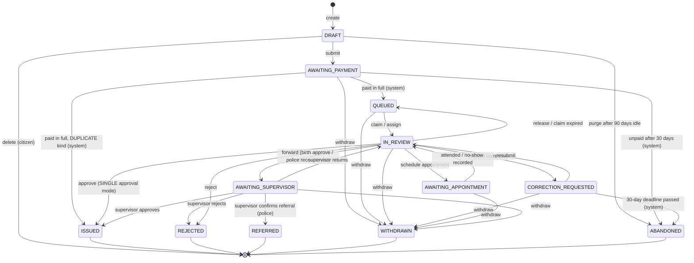
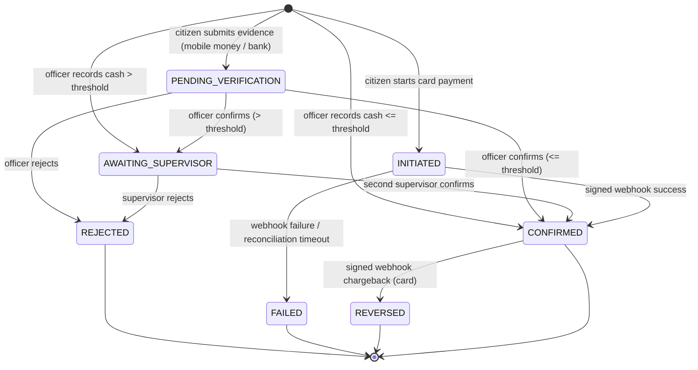
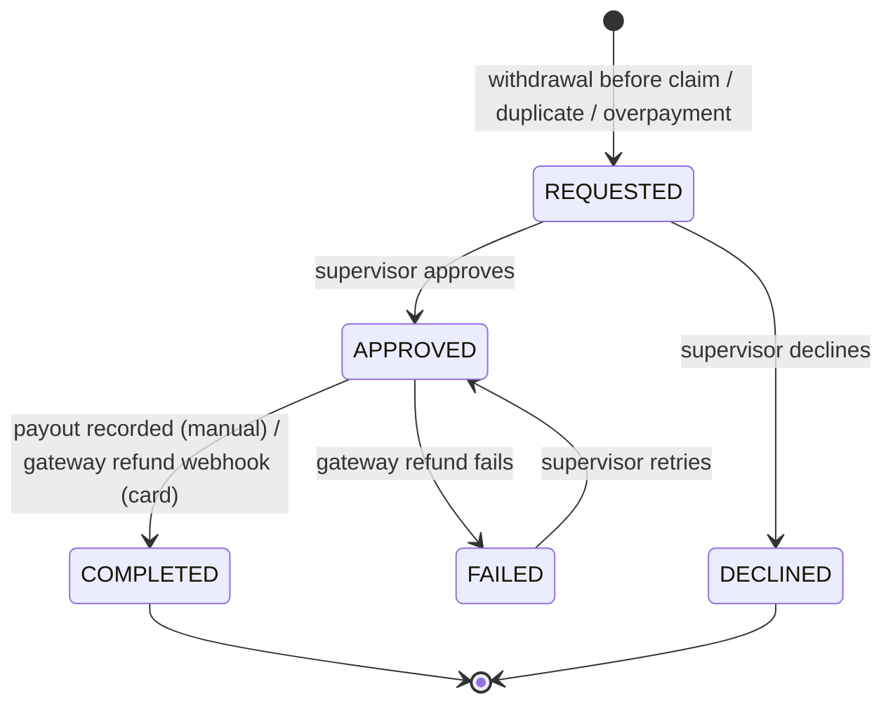
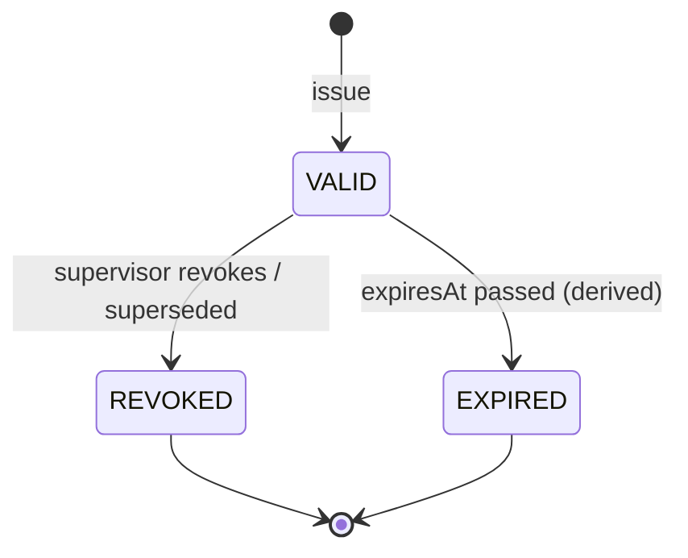

# GovServe state machines

Version 1.0 (Phase 0), 2026-10-13. Requirement numbers refer to docs/SPEC.md.

Rules that apply to every machine:
- Status changes go **only** through the owning state service (`ApplicationStateService`, `PaymentStateService`,
  `CertificateService`, `RefundService`). Code never updates the status column directly.
- Each transition runs in one DB transaction. The transaction checks the actor's role, department scope and guard, writes the
  new status (with an optimistic `version` check), writes a status-history row and **an AuditLog row**, and adds a
  domain event to the outbox. The outbox drives notifications and jobs.
- A transition not listed in these tables returns **409 INVALID_TRANSITION** with no side effects.
- `system` = a scheduled job or an internal handler (webhook, payment completion). It is audited with `actorType=SYSTEM`.
- "Dept" = the actor's department must equal the application's department.

---

## 1. Application

`kind = STANDARD` follows the whole diagram. `kind = DUPLICATE` (FR-094) uses only
DRAFT → AWAITING_PAYMENT → ISSUED (system, on full payment) and WITHDRAWN.

Terminal states: ISSUED, REJECTED, REFERRED, WITHDRAWN, ABANDONED. **Open** = any other state (FR-031).
`chargebackFlag` is an attribute, not a state. While it is set, approval is blocked (FR-075). A supervisor clears it (§1.2).

### 1.1 Transition table
| # | From | To | Actor | Guard | Side effects | Audit event |
| --- | --- | --- | --- | --- | --- | --- |
| A1 | — | DRAFT | citizen | Service active; no open application for the same service and subject (FR-031), except DUPLICATE kind, which needs a VALID source certificate owned by the citizen | Pin current ServiceVersion | APPLICATION_CREATED |
| A2 | DRAFT | (deleted) | citizen (owner) | — | Delete uploads | APPLICATION_DRAFT_DELETED |
| A3 | DRAFT | AWAITING_PAYMENT | citizen (owner) | Email verified; form valid against schema; required docs present and CLEAN; copies 0–5 | Assign reference number; create FeeAssessment; set submittedAt | APPLICATION_SUBMITTED |
| A4 | DRAFT | ABANDONED | system | updatedAt older than 90 days | Purge uploads | APPLICATION_ABANDONED |
| A5 | AWAITING_PAYMENT | QUEUED | system | Sum of CONFIRMED payments ≥ assessment total; kind STANDARD | Start SLA clock; set slaDueAt | APPLICATION_QUEUED |
| A6 | AWAITING_PAYMENT | ISSUED | system | Paid in full; kind DUPLICATE; source certificate still VALID | Issue duplicate certificate (C1) | APPLICATION_ISSUED |
| A7 | AWAITING_PAYMENT | ABANDONED | system | No payment confirmed 30 days after submit (setting) and no payment pending | Refund any partial confirmed payments (R1) | APPLICATION_ABANDONED |
| A8 | QUEUED | IN_REVIEW | officer, supervisor (Dept) | Not claimed (version check); actor active | Set assigneeId, claimExpiresAt = +2 working days | APPLICATION_CLAIMED (or _ASSIGNED by supervisor) |
| A9 | IN_REVIEW | QUEUED | assignee, supervisor (Dept), system | Release requested, or claimExpiresAt passed, or assignee deactivated | Clear assignee | APPLICATION_RELEASED |
| A10 | IN_REVIEW | IN_REVIEW | supervisor (Dept) | Target officer active in Dept | Change assignee (not a status change, but audited) | APPLICATION_REASSIGNED |
| A11 | IN_REVIEW | CORRECTION_REQUESTED | assignee | correctionRound < 3; ≥ 1 flagged item, each with a comment | correctionRound += 1; unlock flagged items; correctionDueAt = +30 days; SLA paused | APPLICATION_CORRECTION_REQUESTED |
| A12 | CORRECTION_REQUESTED | IN_REVIEW | citizen (owner) | Every flagged item changed or re-uploaded; form valid; docs CLEAN | Lock items; resume SLA; keep assignee (if inactive → A9 to QUEUED) | APPLICATION_RESUBMITTED |
| A13 | CORRECTION_REQUESTED | ABANDONED | system | now > correctionDueAt | No refund (review had started) | APPLICATION_ABANDONED |
| A14 | IN_REVIEW | AWAITING_APPOINTMENT | assignee | Service requires an in-person step; no SCHEDULED appointment already; reschedules ≤ 2 | Create Appointment(SCHEDULED); pause SLA; notify | APPOINTMENT_SCHEDULED |
| A15 | AWAITING_APPOINTMENT | IN_REVIEW | assignee, supervisor (Dept) | Appointment time has passed | Appointment → ATTENDED (attendee names for birth) or NO_SHOW; resume SLA | APPOINTMENT_ATTENDED / APPOINTMENT_NO_SHOW |
| A16 | IN_REVIEW | ISSUED | assignee | approvalMode = SINGLE (proof of address; police "no record"); paid in full; required appointment ATTENDED; no chargebackFlag | Issue certificate (C1); supersede any older VALID one (C3); stop SLA; decidedAt | APPLICATION_APPROVED + CERTIFICATE_ISSUED |
| A17 | IN_REVIEW | AWAITING_SUPERVISOR | assignee | Birth: same guards as A16. Police: outcome RECORD_FOUND with an encrypted note, appointment ATTENDED | Record ReviewDecision(level OFFICER) | APPLICATION_FORWARDED |
| A18 | AWAITING_SUPERVISOR | ISSUED | supervisor (Dept) | Not the officer who made the A17 decision; guards of A16 still hold; outcome ≠ RECORD_FOUND | ReviewDecision(level SUPERVISOR); issue certificate (C1, C3) | APPLICATION_APPROVED + CERTIFICATE_ISSUED |
| A19 | AWAITING_SUPERVISOR | REFERRED | supervisor (Dept) | Police service; officer outcome RECORD_FOUND; not the same user | ReviewDecision; notify "visit CID in person" (no details) | APPLICATION_REFERRED |
| A20 | AWAITING_SUPERVISOR | IN_REVIEW | supervisor (Dept) | Note required | Back to the same assignee | APPLICATION_RETURNED |
| A21 | IN_REVIEW, AWAITING_SUPERVISOR | REJECTED | assignee / supervisor (Dept) | Reason code + citizen-visible note | Stop SLA; decidedAt; no refund | APPLICATION_REJECTED |
| A22 | any open state except DRAFT | WITHDRAWN | citizen (owner) | — | If the application was never claimed (A8 never ran): create refund request for all confirmed payments (R1); cancel scheduled appointments | APPLICATION_WITHDRAWN |

### 1.2 Chargeback flag
| From | To | Actor | Guard | Side effects | Audit event |
| --- | --- | --- | --- | --- | --- |
| flag off | flag on | system | Linked payment → REVERSED (P9) | Notify department supervisors | APPLICATION_CHARGEBACK_FLAGGED |
| flag on | flag off | supervisor (Dept) | Decision KEEP (note) or REVOKE (runs C2 with reason CHARGEBACK) | — | APPLICATION_CHARGEBACK_RESOLVED |

---

## 2. Payment

Threshold = setting `payment.supervisorThresholdCents` (default 10000). "> threshold" compares the payment's own
`amountCents`. Refunds do not change the payment's status. They are tracked in Refund (§3), and the payment's
`refundedCents` is derived from COMPLETED refunds.

| # | From | To | Actor | Guard | Side effects | Audit event |
| --- | --- | --- | --- | --- | --- | --- |
| P1 | — | PENDING_VERIFICATION | citizen (owner) | Application AWAITING_PAYMENT; channel MOBILE_MONEY or BANK; (channel, provider, reference) unique among non-REJECTED payments; amount > 0 | Store evidence doc (optional) | PAYMENT_SUBMITTED |
| P2 | — | INITIATED | citizen (owner) | Application AWAITING_PAYMENT; Idempotency-Key unique; amount = outstanding balance | Create gateway session | PAYMENT_INITIATED |
| P3 | — | CONFIRMED | officer, supervisor (Dept) | Cash; amount ≤ threshold; receipt-book reference unique | Issue receipt; evaluate A5/A6 | PAYMENT_CASH_RECORDED + PAYMENT_CONFIRMED |
| P4 | — | AWAITING_SUPERVISOR | officer, supervisor (Dept) | Cash; amount > threshold; reference unique | firstConfirmedBy = actor | PAYMENT_CASH_RECORDED |
| P5 | PENDING_VERIFICATION | CONFIRMED | officer, supervisor (Dept) | amount ≤ threshold; version check (exactly one confirmer wins) | Issue receipt (R-number); evaluate A5/A6 | PAYMENT_CONFIRMED |
| P6 | PENDING_VERIFICATION | AWAITING_SUPERVISOR | officer, supervisor (Dept) | amount > threshold | firstConfirmedBy = actor | PAYMENT_FIRST_CONFIRMED |
| P7 | PENDING_VERIFICATION, AWAITING_SUPERVISOR | REJECTED | officer (from PENDING only), supervisor (Dept) | Reason code + note | Reference released for reuse; notify citizen | PAYMENT_REJECTED |
| P8 | AWAITING_SUPERVISOR | CONFIRMED | supervisor (Dept) | actor ≠ firstConfirmedBy | Issue receipt; evaluate A5/A6 | PAYMENT_CONFIRMED |
| P9 | CONFIRMED | REVERSED | system (webhook) | Card; valid HMAC + timestamp; event not seen before | Set application chargebackFlag (§1.2); receipt shows REVERSED | PAYMENT_REVERSED |
| P10 | INITIATED | CONFIRMED | system (webhook) | Valid HMAC, timestamp within ±5 min, amount matches, providerRef not processed before | Issue receipt; evaluate A5/A6 | PAYMENT_CONFIRMED |
| P11 | INITIATED | FAILED | system (webhook or reconciliation job) | Gateway reports failure, or still pending after 24 h | Notify citizen | PAYMENT_FAILED |

Officers never move a card payment (P10, P11 and P9 have only the `system` actor).
Payments after the application has left AWAITING_PAYMENT, and any amount over the balance, are
**overpayments**. They are confirmed as normal, flagged `overpaidCents`, and are eligible for refund.

---

## 3. Refund

| # | From | To | Actor | Guard | Side effects | Audit event |
| --- | --- | --- | --- | --- | --- | --- |
| R1 | — | REQUESTED | system (A7, A22), officer (Dept) | Reason ∈ {WITHDRAWN_BEFORE_REVIEW, DUPLICATE_PAYMENT, OVERPAYMENT, ABANDONED_UNPAID}; amount ≤ confirmed − already refunded | — | REFUND_REQUESTED |
| R2 | REQUESTED | APPROVED | supervisor (Dept) | — | Card: call gateway refund | REFUND_APPROVED |
| R3 | REQUESTED | DECLINED | supervisor (Dept) | Note required | Notify citizen | REFUND_DECLINED |
| R4 | APPROVED | COMPLETED | supervisor (Dept) for manual payouts; system (webhook) for card | Manual: payout method + reference recorded | Update payment.refundedCents; receipt shows REFUNDED if fully refunded | REFUND_COMPLETED |
| R5 | APPROVED | FAILED | system | Gateway refund error | Notify supervisors | REFUND_FAILED |
| R6 | FAILED | APPROVED | supervisor (Dept) | — | Retry gateway refund | REFUND_RETRIED |

There are no refunds for REJECTED, REFERRED, ABANDONED-after-correction, or applications withdrawn after a claim.

---

## 4. Certificate

The stored status is `VALID | REVOKED`. EXPIRED is **derived** at read time (`expiresAt < now`), so there is no job and no race.
Birth certificates have `expiresAt = null` and never expire. A REVOKED certificate shows REVOKED even after its expiry.

| # | From | To | Actor | Guard | Side effects | Audit event |
| --- | --- | --- | --- | --- | --- | --- |
| C1 | — | VALID | system (inside A6/A16/A18) | Application transition in the same transaction | Certificate number from per-service yearly counter; canonical payload signed with Ed25519 (active keyId); PDF rendered by a BullMQ job (idempotent, retried); duplicate links `duplicateOfId` and copies expiresAt | CERTIFICATE_ISSUED |
| C2 | VALID | REVOKED | supervisor (Dept) | Reason ∈ {FRAUD, ERROR, CHARGEBACK} + note | Public page shows REVOKED; notify holder; revoke VALID duplicates of it too | CERTIFICATE_REVOKED |
| C3 | VALID | REVOKED | system (inside C1) | New STANDARD certificate for the same service and subject | reason SUPERSEDED; supersededById set | CERTIFICATE_SUPERSEDED |
| C4 | (any) | (same) | citizen (owner), staff (Dept) | — | Signed GET for the PDF | CERTIFICATE_DOWNLOADED |
